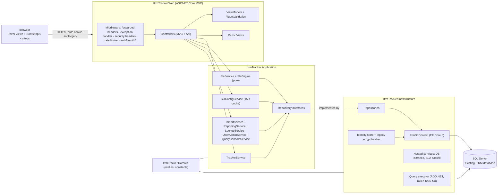

# Architecture

This document has two parts: **(A)** the discovery analysis of the original Node.js application and **(B)** the
architecture of the modernized ASP.NET Core MVC (.NET 8) application in this folder.

---

## A. Current (legacy) architecture – discovery findings

### A.1 Technology and structure

| Aspect | Legacy implementation |
|---|---|
| Runtime | Node.js ≥ 22.5, built-in `http` module (no framework), single process |
| Data access | `mssql` driver, hand-written parameterized T-SQL (`db/database.js` `query/queryOne/transaction`) |
| Database | Microsoft SQL Server 2017+ (`db/schema.sql` + versioned `db/migrations/*.sql`, applied on every start) |
| UI | Single-page app in vanilla JS (`public/app.js` ≈160 KB, `public/stage-sla.js`, `public/index.html`) calling a JSON REST API |
| Auth | Username/password (scrypt hashes in `dbo.users`), server-side sessions in `dbo.sessions`, `itrm_session` HttpOnly cookie, 7-day TTL |
| Hosting | IIS reverse proxy (URL Rewrite + ARR) → Node on 127.0.0.1:3000, started by a Windows scheduled task; or Docker |
| Tests | `node --test`: pure SLA engine tests + service integration tests on an in-memory repository |

```
public/ (SPA)  ──fetch JSON──►  server.js (router + auth gate)  ──►  routes/*.js  ──►  lib/*.js (SLA engine/service)  ──►  db/database.js ──► SQL Server
```

### A.2 Business processes identified

1. **Business request tracking** – register, create/edit/delete, 31 fields incl. 10 pipeline dates, multi tech owners and systems, comments, audit history, personal follow (★).
2. **Incident tracking** – same lifecycle with a reduced field set (no analysis dates, category, BA/BRD/regulatory fields).
3. **Planning-date governance** – two-sided pipeline date order, date range 2020-01-01…2035-12-31, field dependencies (Estimated → dev…deployment dates, BA Required → analysis dates, Regulatory → regulator + deadline).
4. **Legacy SLA calculation** – remaining working days from the current stage through Deployment × priority factor × category factor; target date, gap vs planned go-live and a status flag (at risk / re-baseline / no plan / within SLA / paused / done).
5. **Stage-driven, effort-driven SLA engine** – per-stage state machine (Not Yet Estimated → Not Started → In Progress ⇄ On Hold → Completed / Cancelled, reopen, reinstate), work segments, hold periods, utilization health (On Track / At Risk / Breached), auto-start of the next stage, stage-order rule, request roll-up, dashboard, full audit trail, reconciliation with edits made through the request form, backfill of untracked requests.
6. **Follow-up** – records whose current stage's planned end date is overdue or due within 5 days, plus SLA risks.
7. **Dashboard** – 11 KPIs and 10 breakdown panels (computed in the browser).
8. **Import & merge** – CSV/XLSX upload, header auto-detection, mapping, preview, compare (new / update / duplicate / invalid with field diffs), per-row decisions, merge with auto-created lookup values, import batch history.
9. **Export / sharing** – Excel export (displayed / all columns), copy table, Outlook `.eml` draft of selected records.
10. **Reference data** – 10 editable lookup tables; SLA assumption tables and engine settings editor.
11. **Ad-hoc reporting** – read-only SQL query console with schema browser.
12. **Account administration** – users API (create / update / deactivate / delete), self-service password change.

### A.3 Roles and permissions

| Role (`dbo.users.role`) | Capabilities |
|---|---|
| `read_only` | Read everything; **also allowed**: log out, change own password, run console SELECTs, import *parse/analyze* (preview only), follow/unfollow, **add** comments |
| `read_write` | Everything above plus every mutating operation and the user administration API (incl. its GETs) |

Enforcement was a single gate in `server.js` (method-based + an exemption list); the UI hid `.write-only` elements.

### A.4 Database interactions
All access is parameterized T-SQL through `db/database.js`. Writes to a request run in a transaction together with
its history snapshot (`*_history.snapshot_json`). SLA engine writes lock the request row (`UPDLOCK, HOLDLOCK`).
Startup runs the idempotent schema script and pending migrations (tracked in `dbo.schema_migrations`).
See [DATABASE-MAPPING.md](DATABASE-MAPPING.md) for the full schema.

### A.5 External integrations

| Integration | Direction | Notes |
|---|---|---|
| Microsoft SQL Server | outbound | the only server-side dependency |
| Excel / CSV files | inbound (upload) | dependency-free XLSX (ZIP+XML) and CSV readers |
| Excel export | outbound (download) | SpreadsheetML 2003 `.xls` generated in the browser |
| Microsoft Outlook | outbound (download) | unsent `.eml` draft (`X-Unsent: 1`) generated in the browser – no SMTP |
| Clipboard | browser | copy table / copy BR No & CR |
| Load balancer / monitoring | inbound | `GET /healthz` (also polled by the UI every 20 s) |

No third-party web services, message queues or e-mail servers are called.

### A.6 Background processes and scheduled jobs
* **On startup:** schema + migrations, then a non-blocking **SLA backfill** (`SLA_BACKFILL_ON_START`).
* **After every request-form save:** synchronous SLA reconciliation (`SLA_ENGINE_SYNC`).
* **Manual CLI:** `db/seed.js` (lookups + first admin), `db/migrate.js up|status|backfill|down`, `db/migrate-from-sqlite.js` (one-time SQLite → SQL Server move).
* **Browser:** health heartbeat every 20 s. There are **no cron/scheduled jobs**.

### A.7 Authentication and authorization mechanism
scrypt (N=16384, r=8, p=1, 64-byte key, 16-byte random salt stored as hex `salt$hash`), constant-time comparison,
random 32-byte session token, `HttpOnly; SameSite=Lax` cookie (`Secure` optional), sessions validated on every API
call (active user, not expired). No CSRF tokens (relied on SameSite=Lax + JSON bodies), no lockout / rate limiting.

### A.8 Client-side validations (browser)
Required title; date inputs `min/max`; two-sided pipeline date order with inline errors; password min length 6 and
confirmation match; comment max 2 000 chars; lookup name max 100; saved filter name max 50; stage action dialogs
(planned effort 0.01–999, actual effort 0–9 999, note ≤ 500); import mapping (title required for new rows).

### A.9 Server-side business rules (authoritative)
`routes/validation.js` (dates, title), uniqueness of BR No / Incident ID / CR, lookup-only bulk update, comment body
required, user rules (unique username, role values, cannot deactivate/delete self), SLA config validation
(`routes/sla.js`), stage status validation and state machine (`lib/sla-engine.js`), read-only SQL guard (`routes/query.js`),
import re-validation on commit (`routes/import.js`).

---

## B. Target architecture (modernized)

### B.1 Solution layout

```
ModernizedApp/
├── ItrmTracker.sln
├── Domain/            ItrmTracker.Domain          – entities (one per table) + business constants (no dependencies)
├── Application/       ItrmTracker.Application     – use cases / services, SLA engine, validation, import, reporting (BCL + ASP.NET shared framework only)
│   ├── Services → Sla/, Tracker/, Lookups/, Users/, Import/, Query/, Reporting/, Export/
│   ├── Validation/    – authoritative request rules (port of routes/validation.js)
│   └── Abstractions/  – IClock, ICurrentUser, IAuditLogger; repository interfaces live next to their services
├── Infrastructure/    ItrmTracker.Infrastructure  – EF Core + SQL Server
│   ├── Data/          – ItrmDbContext (Fluent API mapping of the existing schema), unit-of-work helpers
│   ├── Migrations/    – EF Core migrations (embed the original idempotent scripts)
│   ├── Repositories/  – repository implementations
│   ├── Identity/      – ASP.NET Core Identity store over dbo.users, legacy scrypt-compatible hasher
│   ├── Services/      – clock, audit logger, query-console executor
│   └── Seeding/       – startup migration/seed, SLA backfill hosted service
├── Web/               ItrmTracker.Web             – ASP.NET Core MVC
│   ├── Controllers/   – MVC controllers + Api/ (read-only JSON + SLA API + /healthz)
│   ├── ViewModels/    – strongly typed view models
│   ├── Validators/    – FluentValidation validators
│   ├── Views/         – Razor views (Bootstrap 5)
│   ├── Infrastructure/– current user, cookie validation, security headers, error handling, display formatting
│   └── wwwroot/       – site.css, site.js (CSP-compliant, no inline script), Bootstrap 5, jQuery validation
├── Tests/             ItrmTracker.Tests (xUnit)  – engine, service, validation, import, security tests
├── tools/SlaParityCheck – differential test harness against the ORIGINAL JavaScript modules
├── deploy/, Dockerfile, docker-compose.yml
└── Docs/
```

The requested top-level folders map as follows: **Web, Application, Domain, Infrastructure** are projects;
**Data** and **Migrations** live in Infrastructure; **Services** in Application (use cases) and Infrastructure
(technical services); **ViewModels, Controllers, Views** in Web.

### B.2 Architecture diagram



Dependency rule: **Web → Application → Domain** and **Infrastructure → Application/Domain**; Application has no
EF Core or web dependency, so all business logic is unit-testable and was verified against the original code.

### B.3 Request flow (example: start a stage)
1. `POST /StageSla/Change/42` from the details page (antiforgery token, auth cookie).
2. Cookie validation re-checks that the user still exists and is active (immediate effect of deactivation / role change).
3. `[Authorize(Policy = "ReadWrite")]` → FluentValidation (`StageActionInputModelValidator`).
4. `SlaService.UpdateStageStatusAsync` → `ISlaRepository.InTransactionAsync` (EF execution strategy + transaction) →
   row lock `WITH (UPDLOCK, HOLDLOCK)` → `SlaEngine.PlanTransition` → work/hold segments → aggregates → audit rows →
   legacy stage/status mirroring.
5. Audit log entry (`ItrmTracker.Audit`, event 9000), redirect back to `#stage-sla` with a success/error message.

### B.4 Cross-cutting concerns

| Concern | Implementation |
|---|---|
| Authentication | ASP.NET Core Identity (`AddIdentityCore` + custom `AppUserStore` over `dbo.users`), cookie `itrm_auth` (HttpOnly, SameSite=Lax, configurable Secure, 7 days fixed) |
| Passwords | Identity V3 PBKDF2 for new hashes; legacy scrypt hashes verified and transparently upgraded on login (configurable `LegacyScrypt` mode for parallel run) |
| Authorization | Fallback policy = authenticated; `ReadWrite` policy on every mutating action; documented read-only exemptions preserved |
| CSRF | Global `AutoValidateAntiforgeryToken`; header `X-CSRF-TOKEN` for JSON calls |
| XSS | Razor encoding everywhere, strict CSP (`script-src 'self'`, no inline scripts), `X-Content-Type-Options`, `X-Frame-Options: DENY` |
| SQL injection | EF Core LINQ / parameterized interpolated SQL only; query console guarded + sensitive tables blocked + always-rolled-back transaction |
| Brute force | Rate limiter on login (10/min/IP) |
| Validation | FluentValidation (UI rules) + Application rules (authoritative, original messages) |
| Error handling | Global exception handler with trace id; friendly error page; API errors as `{ errors: [...] }` |
| Logging | `ILogger` structured logging; audit category `ItrmTracker.Audit` |
| Caching | `IMemoryCache`: SLA configuration (15 s, as before) and lookups (30 s, invalidated on change) |
| Resilience | EF Core SQL Server retry-on-failure (5 retries) wrapping each unit of work |
| Performance | `AsNoTracking` projections, single round-trip per collection (split link queries), response compression, static file caching |
| Background work | `SlaBackfillHostedService`, startup `DatabaseInitializer` |

### B.5 Design decisions
* **Existing database, no schema change.** The EF model maps the legacy snake_case schema 1:1; Identity uses the
  existing `dbo.users` table instead of introducing `AspNet*` tables, so both applications can run side by side.
* **Business logic ported, not re-invented.** SLA engine, legacy SLA, validation, import parsing, CSV/XLSX readers and
  the SQL guard are line-by-line ports with identical messages, verified by differential testing (see MIGRATION-SUMMARY).
* **Browser logic moved to the server.** Dashboard, follow-up, filtering, sorting, export and history diffs were
  computed in the browser; they are now Application services (testable, no full-table JSON download).
* **One tracker service for two trackers.** The near-duplicate business-request and incident routes are unified in
  `TrackerService` / `TrackerControllerBase` with a `TrackerKind`.
* **No new third-party packages beyond EF Core and FluentValidation.** XLSX reading/writing, scrypt and `.eml`
  generation use only the BCL.
